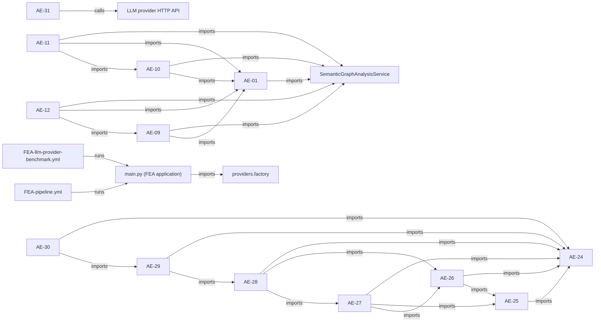

# AE-32A — Architecture and Wiring Audit

- **Report schema:** `ae32a/architecture-wiring-report/v1`
- **Audit status:** `complete`
- **Manifest SHA-256:** `661e2e676a474d1118c6c34281fddc28d418fa2f551b70cc8107457000748c31`
- **Inspected source revision:** `not supplied`
- **Trusted runner revision:** `not supplied`
- **Scoped files:** 1601 included; 988 Python files; 18 active workflow files
- **Python parse issues:** 0
- **Scope issues:** 0

> This is a report-only static inspection. It does not import repository modules, execute workflows, call LLM providers, or modify repository source. Test-file presence is not a test-pass claim; source-level wiring is not proof of runtime use.

## Capability matrix

| Component | Implemented | Test file present | Production consumer | AE-stage consumer | Workflow invokes | Calls LLM API | Graph API | Exposed as LLM tool | Measurement evidence | Live-model quality measured |
|---|---:|---:|---:|---:|---:|---:|---:|---:|---|---:|
| `ae01` | yes | yes | not detected | yes | not detected | not detected | yes | not detected | none observed | not observed |
| `ae02` | yes | yes | not detected | yes | not detected | not detected | not detected | not detected | none observed | not observed |
| `ae03` | yes | yes | not detected | yes | not detected | not detected | not detected | not detected | none observed | not observed |
| `ae04` | yes | yes | not detected | yes | not detected | not detected | not detected | not detected | none observed | not observed |
| `ae05` | yes | yes | not detected | yes | not detected | not detected | not detected | not detected | none observed | not observed |
| `ae06` | yes | yes | not detected | yes | not detected | not detected | not detected | not detected | none observed | not observed |
| `ae07` | yes | yes | not detected | not detected | not detected | not detected | not detected | not detected | none observed | not observed |
| `ae08` | yes | yes | not detected | not detected | not detected | not detected | not detected | not detected | none observed | not observed |
| `ae09` | yes | yes | not detected | yes | not detected | not detected | yes | not detected | none observed | not observed |
| `ae10` | yes | yes | not detected | yes | not detected | not detected | yes | not detected | none observed | not observed |
| `ae11` | yes | yes | not detected | not detected | not detected | not detected | yes | not detected | none observed | not observed |
| `ae12` | yes | yes | not detected | not detected | not detected | not detected | yes | not detected | none observed | not observed |
| `ae13` | yes | yes | yes | yes | not detected | not detected | yes | not detected | none observed | not observed |
| `ae14` | yes | not detected | not detected | yes | not detected | not detected | not detected | not detected | none observed | not observed |
| `ae15` | yes | yes | not detected | yes | not detected | not detected | yes | not detected | none observed | not observed |
| `ae16` | yes | yes | not detected | yes | not detected | not detected | yes | not detected | none observed | not observed |
| `ae17` | yes | yes | not detected | yes | not detected | not detected | not detected | not detected | none observed | not observed |
| `ae18` | yes | yes | not detected | yes | not detected | not detected | not detected | not detected | evaluation | not observed |
| `ae19` | yes | yes | not detected | yes | not detected | not detected | not detected | not detected | evaluation | not observed |
| `ae20` | yes | yes | not detected | not detected | not detected | not detected | not detected | not detected | evaluation | not observed |
| `ae21` | yes | yes | not detected | not detected | not detected | not detected | not detected | not detected | evaluation | not observed |
| `ae22` | yes | yes | not detected | yes | not detected | not detected | not detected | not detected | evaluation | not observed |
| `ae23` | yes | yes | not detected | not detected | not detected | not detected | not detected | not detected | none observed | not observed |
| `ae24` | yes | yes | not detected | yes | not detected | not detected | yes | not detected | none observed | not observed |
| `ae25` | yes | yes | not detected | yes | not detected | not detected | yes | not detected | none observed | not observed |
| `ae26` | yes | yes | not detected | yes | not detected | not detected | not detected | not detected | none observed | not observed |
| `ae27` | yes | yes | not detected | yes | not detected | not detected | not detected | not detected | none observed | not observed |
| `ae28` | yes | yes | not detected | yes | not detected | not detected | not detected | not detected | none observed | not observed |
| `ae29` | yes | yes | not detected | yes | not detected | not detected | not detected | not detected | none observed | not observed |
| `ae30` | yes | yes | not detected | not detected | not detected | not detected | not detected | not detected | evaluation | not observed |
| `ae31` | yes | yes | not detected | not detected | not detected | yes | not detected | not detected | operational | not observed |

## Shared infrastructure wiring

- **Semantic graph analysis service:** implementation present; 62 distinct source files import graph-analysis APIs across 92 import occurrences.
- **Literal `graph_engine/` directory:** 0 Python files and 2 scoped non-Python files were found. This describes that directory only; graph implementation elsewhere is inventoried separately.
- **Shared provider factory:** implementation present = `true`; 1 production import consumer(s), 1 test consumer(s). The detected AE-31 model requests use direct HTTP transport instead of importing the factory.
- **AE-28 model boundary:** response-intake/validation functions are present, but AE-28 itself has no detected provider HTTP transport; a separate caller must obtain the model response.
- **AE-29 verification boundary:** the controller validates supplied verification records, but no test-runner invocation was detected inside AE-29.
- **Separate `decision_memory/` package:** present = `true`; 1 external production consumer(s), plus 15 imports within the package. AE-29's local `DecisionMemory` has no observed import bridge to this package.
- **Workflow invocation:** 18 active workflow files and 1 nested/archived workflow candidates were inventoried; 0 active workflow command(s) directly invoke an AE package CLI in this source tree.
- **Measurement boundary:** AE-30 provides synthetic control-loop evaluation; AE-31 reports provider operational telemetry, but no live-model diagnosis-quality metric was observed.

## Findings

### AE32A-AE29-VERIFICATION-RECEIPT-ONLY — AE-29 validates verification evidence but does not run the verification tests itself

**Severity:** `high`

The controller exposes verification/iteration gate APIs and validates a supplied verification record. No test-runner or subprocess execution call was observed inside AE-29. Consequently, a valid verification receipt can be checked for consistency and binding, but this component alone does not execute the tests that generated it.

Evidence:
- `audit_engine/semantic_audit/ae29/controller.py:707` — verification_gate_api: function: make_verification
- `audit_engine/semantic_audit/ae29/controller.py:764` — verification_gate_api: function: validate_verification
- `audit_engine/semantic_audit/ae29/controller.py:1004` — verification_gate_api: function: evaluate_iteration

*Limitation: The design may intentionally delegate execution to an external verifier. The integration that executes tests and produces a trustworthy receipt must be separately wired and audited.*

### AE32A-FIXED-DIAGNOSTIC-CONTEXT — LLM diagnosis context is assembled from a fixed file allowlist

**Severity:** `high`

The diagnosis component declares explicit input/context path lists and no graph-query API was observed in that component. This limits discovery to files selected in advance instead of following dependencies from the current failure.

Evidence:
- `audit_engine/semantic_audit/ae31/diagnosis.py:77` — fixed_context_allowlist: fixed context declaration: INPUT_PATHS
- `audit_engine/semantic_audit/ae31/diagnosis.py:98` — fixed_context_allowlist: fixed context declaration: CODE_CONTEXT_PATHS
- `audit_engine/semantic_audit/ae31/diagnosis.py:107` — fixed_context_allowlist: fixed context declaration: ARCHITECTURE_CONTEXT_PATHS

*Limitation: A fixed allowlist is a legitimate security boundary for a narrow diagnostic. The gap is the absence of a safe, queryable evidence-selection tool within that boundary, not the existence of a boundary itself.*

### AE32A-GRAPH-NOT-IN-LLM-PATH — Graph analysis is used elsewhere but not in the detected LLM request path

**Severity:** `high`

The repository contains consumers of SemanticGraphAnalysisService, but none of the detected LLM-requesting AE components shows direct graph-query evidence. The graph and LLM capabilities therefore appear adjacent rather than integrated in the audited source path.

Evidence:
- `audit_engine/semantic_audit/ae01/pipeline.py:10` — graph_import: audit_engine.semantic_audit.ae01.pipeline imports audit_engine.semantic_audit.graph
- `audit_engine/semantic_audit/ae01/publication.py:93` — graph_import: audit_engine.semantic_audit.ae01.publication imports audit_engine.semantic_audit.graph.analysis.identity
- `audit_engine/semantic_audit/ae09/investigate.py:20` — graph_import: audit_engine.semantic_audit.ae09.investigate imports audit_engine.semantic_audit.graph.analysis.identity
- `audit_engine/semantic_audit/ae10/science.py:18` — graph_import: audit_engine.semantic_audit.ae10.science imports audit_engine.semantic_audit.graph.analysis.identity
- `audit_engine/semantic_audit/ae11/numerics.py:17` — graph_import: audit_engine.semantic_audit.ae11.numerics imports audit_engine.semantic_audit.graph.analysis.identity
- `audit_engine/semantic_audit/ae12/analyze.py:19` — graph_import: audit_engine.semantic_audit.ae12.analyze imports audit_engine.semantic_audit.graph.analysis.engine
- `audit_engine/semantic_audit/ae13/admission.py:7` — graph_import: audit_engine.semantic_audit.ae13.admission imports audit_engine.semantic_audit.graph.analysis.identity
- `audit_engine/semantic_audit/ae13/bindings.py:11` — graph_import: audit_engine.semantic_audit.ae13.bindings imports audit_engine.semantic_audit.graph.analysis
- `audit_engine/semantic_audit/ae15/flow.py:21` — graph_import: audit_engine.semantic_audit.ae15.flow imports audit_engine.semantic_audit.graph.analysis.identity
- `audit_engine/semantic_audit/ae15/publication.py:20` — graph_import: audit_engine.semantic_audit.ae15.publication imports audit_engine.semantic_audit.graph.analysis.identity
- `audit_engine/semantic_audit/ae16/operations.py:19` — graph_import: audit_engine.semantic_audit.ae16.operations imports audit_engine.semantic_audit.graph.analysis.identity
- `audit_engine/semantic_audit/ae24/contracts.py:16` — graph_import: audit_engine.semantic_audit.ae24.contracts imports audit_engine.semantic_audit.graph.analysis.identity

*Limitation: Indirect use through an external process or runtime wrapper is not visible to static source analysis.*

### AE32A-LLM-ISOLATION-AE31 — ae31 makes LLM requests without observed graph/tool integration

**Severity:** `high`

Static inspection found a model-provider HTTP call but no graph-query API use or explicit model tool-dispatch loop in this component. If the intended behavior is interactive repository investigation, the model currently appears to receive preassembled context rather than request graph-grounded tools.

Evidence:
- `audit_engine/semantic_audit/ae31/diagnosis.py:967` — llm_transport_call: network call requests.post in a file containing a model endpoint indicator
- `audit_engine/semantic_audit/ae31/diagnosis.py:1032` — llm_transport_call: network call requests.post in a file containing a model endpoint indicator
- `audit_engine/semantic_audit/ae31/diagnosis.py:1115` — llm_transport_call: network call requests.post in a file containing a model endpoint indicator
- `audit_engine/semantic_audit/ae31/diagnosis.py:77` — fixed_context_allowlist: fixed context declaration: INPUT_PATHS
- `audit_engine/semantic_audit/ae31/diagnosis.py:98` — fixed_context_allowlist: fixed context declaration: CODE_CONTEXT_PATHS
- `audit_engine/semantic_audit/ae31/diagnosis.py:107` — fixed_context_allowlist: fixed context declaration: ARCHITECTURE_CONTEXT_PATHS

*Limitation: This is a source-level observation; it does not establish that the provider call fails or that no external wrapper supplies additional context.*

### AE32A-NO-TOOL-LOOP — No explicit LLM tool-use loop was observed

**Severity:** `high`

The scanned Python source did not expose both a detectable model tool-call protocol and a corresponding tool-dispatch mechanism. Provider HTTP calls alone are not equivalent to an LLM that can request repository inspection tools over multiple turns.

*Limitation: Detection is heuristic and may miss a tool loop implemented through an indirect or differently named abstraction.*

### AE32A-AE28-EXTERNAL-MODEL-INPUT — AE-28 validates externally supplied model output but does not call an LLM provider

**Severity:** `medium`

The component exposes model-response intake/validation functions, but no direct provider transport was observed in AE-28. It is a boundary for validating an output supplied by another caller, not a model invocation or interactive tool loop by itself.

Evidence:
- `audit_engine/semantic_audit/ae28/adapter.py:217` — external_model_response_intake: function: verify_request
- `audit_engine/semantic_audit/ae28/adapter.py:356` — external_model_response_intake: function: ingest_model_response

*Limitation: This is an intentional adapter boundary if a separate orchestrator supplies model output; the missing capability is the orchestration path, not necessarily AE-28 itself.*

### AE32A-DECISION-MEMORY-BRIDGE-NOT-OBSERVED — AE-29 local DecisionMemory is not wired to the separate decision_memory package

**Severity:** `medium`

AE-29 defines and uses a bounded in-memory DecisionMemory type, while the repository also contains a separate decision_memory package. No import bridge from AE-29 to that package was observed in the scanned source. Cross-run reuse through the shared package is therefore not established by this path.

Evidence:
- `audit_engine/semantic_audit/ae29/__init__.py:15` — decision_memory_indicator: indicator: DecisionMemory
- `audit_engine/semantic_audit/ae29/__init__.py:39` — decision_memory_indicator: indicator: DecisionMemory
- `audit_engine/semantic_audit/ae29/controller.py:568` — decision_memory_indicator: indicator: decision_memory
- `audit_engine/semantic_audit/ae29/controller.py:993` — decision_memory_indicator: indicator: decision_memory
- `audit_engine/semantic_audit/ae29/controller.py:1013` — decision_memory_indicator: indicator: DecisionMemory
- `audit_engine/semantic_audit/ae29/controller.py:1206` — decision_memory_indicator: indicator: DecisionMemory
- `audit_engine/semantic_audit/ae29/controller.py:1258` — decision_memory_indicator: indicator: decision_memory
- `audit_engine/semantic_audit/ae29/controller.py:1484` — decision_memory_indicator: indicator: DecisionMemory
- `audit_engine/semantic_audit/ae29/controller.py:1651` — decision_memory_indicator: indicator: DecisionMemory

*Limitation: The two memory implementations may intentionally serve different purposes; this report does not assume they should be merged.*

### AE32A-NO-TEST-REFERENCE-AE14 — No direct test reference was observed for ae14

**Severity:** `medium`

The scanner found implementation files but no test file that directly imports or references this component. This is a coverage signal, not proof that the code is untested through another path.

Evidence:
- `audit_engine/semantic_audit/ae14/` — component_inventory: 2 Python source files discovered

*Limitation: Indirect or generated test coverage may not be detected by static references.*

### AE32A-PROVIDER-PATH-DUPLICATION — AE-31 uses direct provider HTTP transport rather than the shared provider factory

**Severity:** `medium`

The repository has a shared provider factory used by the FEA entrypoint, while the detected AE-31 LLM requests are implemented directly in the diagnosis module. This duplicates provider transport/configuration paths and makes common retry, telemetry, and adapter behavior harder to reuse.

Evidence:
- `audit_engine/semantic_audit/ae31/diagnosis.py:967` — llm_transport_call: network call requests.post in a file containing a model endpoint indicator
- `audit_engine/semantic_audit/ae31/diagnosis.py:1032` — llm_transport_call: network call requests.post in a file containing a model endpoint indicator
- `audit_engine/semantic_audit/ae31/diagnosis.py:1115` — llm_transport_call: network call requests.post in a file containing a model endpoint indicator

*Limitation: A dedicated report-only diagnostic may intentionally require different limits or endpoints; the finding recommends reviewing the boundary, not blindly replacing it.*

### AE32A-SYNTHETIC-EVAL-ONLY — AE-30 evaluation evidence is synthetic control-loop evaluation, not live diagnosis qualification

**Severity:** `medium`

The evaluator contains expected/actual case outcomes but no live model transport. This supports control-loop transition testing, not a claim that a live LLM can find real repository defects or produce correct patches.

Evidence:
- `audit_engine/semantic_audit/ae30/evaluator.py:1` — evaluation_indicator: evaluation-related field or symbol detected
- `audit_engine/semantic_audit/ae30/evaluator.py:4` — evaluation_indicator: evaluation-related field or symbol detected
- `audit_engine/semantic_audit/ae30/evaluator.py:38` — evaluation_indicator: evaluation-related field or symbol detected
- `audit_engine/semantic_audit/ae30/evaluator.py:48` — evaluation_indicator: evaluation-related field or symbol detected
- `audit_engine/semantic_audit/ae30/evaluator.py:49` — evaluation_indicator: evaluation-related field or symbol detected
- `audit_engine/semantic_audit/ae30/evaluator.py:50` — evaluation_indicator: evaluation-related field or symbol detected
- `audit_engine/semantic_audit/ae30/evaluator.py:111` — evaluation_indicator: evaluation-related field or symbol detected
- `audit_engine/semantic_audit/ae30/evaluator.py:129` — evaluation_indicator: evaluation-related field or symbol detected
- `audit_engine/semantic_audit/ae30/evaluator.py:130` — evaluation_indicator: evaluation-related field or symbol detected
- `audit_engine/semantic_audit/ae30/evaluator.py:153` — evaluation_indicator: evaluation-related field or symbol detected

*Limitation: The report does not infer the result of any live-provider run from synthetic tests.*

### AE32A-NO-GENERAL-AE-WORKFLOW — No workflow invocation of an AE package CLI was observed in the scanned tree

**Severity:** `info`

The scanned GitHub workflow commands invoke application entrypoints and validation tools, but no command directly invokes an audit_engine.semantic_audit.aeNN module. Component tests and a module CLI do not by themselves establish an operational repository-audit workflow.

Evidence:
- `.github/workflows/05_semantic_graph_analysis_validation.yml:34` — workflow_command: python <script> -> tools/validate_semantic_graph_analysis.py
- `.github/workflows/06_semantic_verification_validation.yml:38` — workflow_command: python <script> -> tools/validate_semantic_verification.py
- `.github/workflows/07_semantic_domain_verification_validation.yml:29` — workflow_command: python <script> -> tools/validate_semantic_domain_verification.py
- `.github/workflows/08_semantic_graph_evolution_validation.yml:29` — workflow_command: python <script> -> tools/validate_semantic_graph_evolution.py
- `.github/workflows/09_semantic_incremental_reverification_validation.yml:32` — workflow_command: python <script> -> tools/validate_semantic_incremental_reverification.py
- `.github/workflows/10_semantic_reverification_execution_validation.yml:34` — workflow_command: python <script> -> tools/validate_semantic_reverification_execution.py
- `.github/workflows/11_semantic_audit_orchestration_validation.yml:38` — workflow_command: python <script> -> tools/validate_semantic_audit_orchestration.py
- `.github/workflows/12_semantic_adaptive_orchestration_validation.yml:41` — workflow_command: python <script> -> tools/validate_semantic_adaptive_orchestration.py
- `.github/workflows/13_semantic_reverification_orchestration_integration_validation.yml:44` — workflow_command: python <script> -> tools/validate_semantic_reverification_orchestration_integration.py
- `.github/workflows/14_semantic_high_assurance_verification_validation.yml:43` — workflow_command: python <script> -> tools/validate_semantic_high_assurance_verification.py
- `.github/workflows/15_semantic_solver_witness_validation.yml:43` — workflow_command: python <script> -> tools/validate_semantic_solver_witness.py
- `.github/workflows/16_semantic_external_solver_validation.yml:43` — workflow_command: python <script> -> tools/validate_semantic_external_solver.py

*Limitation: The audit covers only workflow files present in the supplied source tree. A workflow stored only on another branch is outside this scan.*

## Observed wiring summary

- AE component packages discovered: **31**.
- Components with test references: **30**.
- Components with direct graph API evidence: **10**.
- Components making detected LLM HTTP calls: **1**.
- Components with explicit tool-loop indicators: **0**.
- Workflows that invoke an AE module CLI: **0**.

## Execution/dependency map

The Mermaid map contains only statically observed production import and workflow-command edges. It intentionally does not draw edges for capabilities that were not observed.

## Scope and limitations

- The source manifest records repository-relative paths, byte sizes, and SHA-256 hashes for included source/configuration/workflow/test/documentation files.
- Exact `.git`, virtual-environment, cache, generated runtime-state, and report-output paths are excluded; symlinks are not followed.
- Import resolution is static and conservative. Dynamic imports, reflection, plugin discovery, shell-generated commands, and runtime monkey-patching may be missed.
- A static absence is reported as `not observed`, not as proof of non-existence.
- The scanner does not modify source/configuration files. When an output directory is supplied, it writes report artifacts there.
- This stage does not attempt to correct code or evaluate scientific content.
